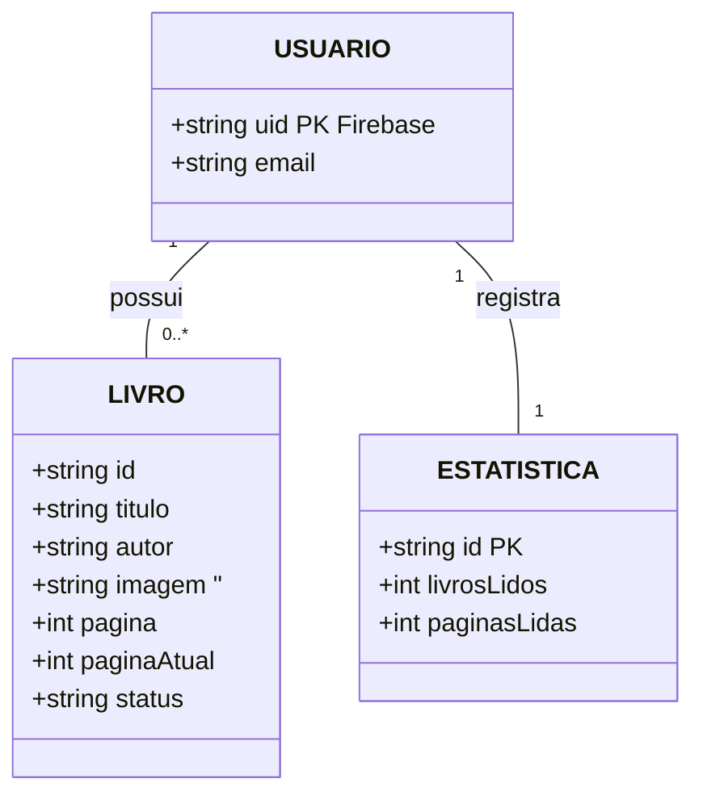

# Sistema de Gestão de Biblioteca Pessoal e Leitura - Book Nook

### Desafio
Desenvolver uma aplicação mobile/web que permita ao leitor cadastrar e buscar livros integrando-se de forma transparente à Google Books API, além de gerenciar a sua estante pessoal dividida por status de leitura. O sistema deve permitir a atualização contínua do progresso de leitura (página atual), calcular automaticamente métricas e porcentagens de conclusão, e registrar histórico de estatísticas. A solução deve garantir autenticação segura por usuário e persistência de dados em tempo real com regras estritas de acesso à informação.

### 1. Introdução
Este documento especifica os requisitos de software do Book Nook, uma aplicação multiplataforma desenvolvida em Flutter/Dart, com Firebase Authentication e Cloud Firestore, que permite a autenticação de usuários, a busca e o cadastro de livros pela Google Books API, o gerenciamento do acervo pessoal com transição entre estantes e a visualização de estatísticas de leitura. Durante o desenvolvimento, encontrei uma limitação no Firebase, que passou a exigir o plano pago (Blaze) e um cartão de crédito para ativar a API necessária ao deploy das Functions. Para contornar esse problema, transferi a lógica de negócio para o frontend e utilizei o `WriteBatch` do Firestore em Dart, garantindo que a atualização do estado dos livros e das estatísticas ocorra de forma atômica e segura.
### 2. Requisitos de Infraestrutura e Ambiente
Categoria | Especificações | Versão |
| --- | --- | --- |
| Sistema Operacional | Android | Android 10+ |
| Front-End / Mobile | Flutter (Dart) | Flutter 3.x / Dart 3.x |
| Autenticação | Firebase Authentication | SDK v10+ | 
| SGBD / Banco de Dados | Cloud Firestore (NoSQL em tempo real) |Native Mode |
| API Externa | Google Books API (REST / HTTP) | v1 |

### 3. Requisitos do Sistema
#### 3.1. Requisitos Funcionais (RF)
- **RF-01: Tela de Login e Registro-** Permitir a autenticação e criação de conta de usuários através do Firebase Authentication
- **RF-02: Aviso de Falha de Autenticação -** Exibir alertas visuais (SnackBars/Dialogs) em caso de credenciais inválidas ou erro de rede.
- **RF-03: Botão de Logout -** Encerrar a sessão do usuário com segurança e redirecionar para a tela de autenticação.
- **RF-04: Navegação por Abas (Estantes) -** Permitir a navegação entre as categorias de leitura: Quero Ler, Lendo e Lidos.
- **RF-05: Busca de Livros Externa (Google Books API) -** Interface de pesquisa conectada à API do Google Books para importar título, autor, capa e total de páginas.
- **RF-06: Listar Livros Cadastrados na Estante -** Exibir os livros salvos no acervo do usuário organizados em cards com imagem de capa e metadados.
- **RF-07: Transição de Status do Livro -** Mover livros entre as estantes (ex: alterar de Quero Ler para Lendo ou de Lendo para Lidos).
- **RF-08: Atualização de Progresso Pessoal -** Permitir que o usuário insira a página atual em que parou no livro durante a leitura.
- **RF-09: Exclusão de Livros da Estante -** Permitir a remoção de um livro com caixa de diálogo de confirmação prévia.
- **RF-10: Exibição do Painel de Estatísticas -** Tela com indicadores visuais: barra de progresso da biblioteca (% concluída), total de livros lidos e total de páginas lidas
- **RF-11: Validação de Dados de Entrada -** Impedir a inserção de páginas atuais negativas ou superiores ao total de páginas do livro.
- **RF-12: Isolamento de Dados do Usuário (Regras de Segurança) -** Garantir no Firestore que cada usuário leia e escreva estritamente na sua própria subcoleção de dados.

### 4. Diagrama Entidade-Relacionamento 

    
    

### 5. Casos de Teste de Software
| ID | Descrição | Passo a Passo | Resultado Esperado | 
| --- | --- | --- | --- | 
| CT01 | Login Válido | 1. Inserir e-mail e senha corretos. 2. Clicar em "Entrar". | Autenticação realizada e redirecionamento para a HomeScreen (Estante). |
| CT02 | Login Inválido | 1. Inserir e-mail/senha incorretos.2. Clicar em "Entrar". | Exibição de mensagem de erro/SnackBar informando falha na autenticação. | 
| CT03 | Busca e Adição de Livro via API | 1. Ir em "Buscar Livros". 2. Digitar "Alice no País das Maravilhas". 3. Clicar em "Adicionar à Estante". | O livro é salvo no Firestore sob a subcoleção do usuário na aba selecionada pelo usuário | 
| CT04 | Atualização de Progresso de Leitura | 1. Ir à aba "Lendo". 2. Clicar no ícone de editar página. 3. Digitar "45" e clicar em "Salvar". | A barra de progresso do livro atualiza para a página 45 com a porcentagem correspondente. | 
| CT05 | Conclusão de Livro e Atualização de Estatísticas | 1. Na aba "Lendo", clicar em "Concluir". 2. Abrir o painel de Estatísticas. | O livro migra para a aba "Lidos", a contagem de livros lidos incrementa em 1 e as páginas lidas são somadas ao gráfico. |
| CT06 | Exclusão de Livro da Estante | 1. Clicar no ícone de lixeira do livro. 2. Confirmar a remoção no diálogo modal. | O documento do livro é excluído do Firestore e removido da lista instantaneamente. |
